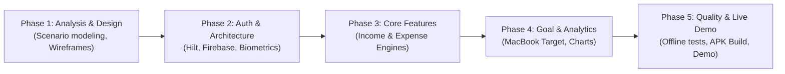

# Clarity  Personal Finance Management System for Android
> **A Problem-First, Scenario-Driven Android Financial Operating System**  
> *Module:* SE3092  Platform Based Development (Assignment 01)  
> *Academic Year:* Year 3, Semester 2 (2026)  
> *Target SDK:* Android API 34+ (Minimum API 26 - Android 8.0 Oreo)

---

## 📌 Executive Summary & Context

**Clarity** is an Android personal finance management system engineered to solve the real-world financial friction experienced by **Kavindu Silva** — a 25-year-old junior software engineer in Colombo earning ~LKR 1.6M annually across four volatile income streams, yet struggling with only LKR 11,200 in savings and an elusive LKR 490,000 MacBook Pro M4 goal.

Previous solutions (spreadsheets, generic budgeting apps, note dumps, bank summaries) failed due to high entry friction, rigid single-currency models, and lack of motivational goal grounding. **Clarity** addresses these root causes with:
1. **Immediate Income & Expense Visibility** (Multi-currency, irregular income reconciliation, committed vs. discretionary categorization).
2. **Actionable Goal Grounding** (Directly tying daily cash flow to his MacBook Pro M4 savings target).
3. **Frictionless, Secure Mobile Experience** (Android Biometrics, Jetpack Compose, and offline-capable Firebase synchronization).

---

## 🎯 What We Are Gonna Do (Core Features & Scope)

### 1.  Secure Authentication & Native Biometrics
- **Firebase Authentication**: Email & password authentication with strict client/cloud validation and Firestore security rules.
- **Biometric Authentication (Fingerprint)**: First-time credential login transitions seamlessly into fast, one-touch biometric verification via `androidx.biometric.BiometricPrompt`.
- **Protected Sessions**: Secure credential and state management allowing quick re-entry without compromising financial data privacy.

### 2.  Multi-Source Income Tracking
- **Four Distinct Streams**:
  - **Fixed & Bonus Salary**: Base salary + performance bonus tracking (25th of each month).
  - **Freelance Engagements**: Project-based milestone invoicing and outstanding payment reconciliation.
  - **Google AdSense (USD)**: Foreign currency revenue with conversion rate recording into LKR.
  - **Cryptocurrency Position (Binance)**: Running net balance and realized gains/losses across USDT, ETH, and altcoins.
- **True Monthly Income Calculation**: Aggregates variable streams into an accurate, predictable monthly earning figure.

### 3.  Frictionless Expense Management
- **Rapid Expense Entry**: Optimized for minimal taps to record cash, card, and ride-hailing (PickMe, UberEats) transactions immediately.
- **Committed vs. Discretionary Categorization**: Automatically highlights fixed living costs (rent, utilities, subscriptions) versus impulsive lifestyle spending.
- **Recurring Expense Engine**: Automatic generation of predictable monthly debits (gym memberships, cloud subscriptions).

### 4.  MacBook Goal Engine & Savings Tracker
- **Dedicated Target Tracking**: Quantified LKR 490,000 fund for the MacBook Pro M4 with a 12-month horizon.
- **Dynamic Savings Rate Calculator**: Computes required monthly and weekly savings based on current cash flow.
- **Visual Progress & Projections**: Real-time progress indicators connecting daily discipline directly to the goal deadline.

### 5.  Clarity Dashboard & Visual Analytics
- **Net Financial Position**: Real-time snapshot of liquid cash, monthly savings velocity, and net burn rate.
- **Distribution Charts**: Clear visual breakdowns of spending patterns to eliminate financial obscurity.
- **Alerts & Friction Reduction**: Gentle reminders for unrecorded days and recurring bill renewals.

---

## 🏗️ Technical Architecture & Technology Stack

| Layer | Technology | Purpose / Justification |
| :--- | :--- | :--- |
| **Language** | **Kotlin 100%** | Idiomatic, modern, null-safe Android development (no Java). |
| **UI Framework** | **Jetpack Compose + Material 3** | Declarative UI, responsive layout without unneeded scroll overhead, modern theme system. |
| **Architecture** | **Strict MVVM + Clean Architecture** | Unidirectional Data Flow (UDF), isolated business logic, zero Android/Compose dependencies in ViewModels. |
| **Dependency Injection** | **Dagger Hilt** | Clean dependency provisioning across repositories, use cases, and ViewModels. |
| **Authentication** | **Firebase Auth** | Industry-standard identity management, secure user tokens. |
| **Cloud Storage** | **Cloud Firestore** | NoSQL document database, real-time snapshot listeners, fine-grained `firestore.rules`. |
| **Local Cache** | **Firestore Offline Persistence + DataStore** | Offline-first UX, zero crashes or blank screens under network drops. |
| **Biometrics** | **AndroidX Biometric API** | Native hardware-backed fingerprint verification. |

---

## 👥 Work Division (Equal-Weight Vertical Slices)

| Team Member | Role | Vertical Feature Slice | Cross-Cutting Responsibility |
| :--- | :--- | :--- | :--- |
| **Member A** | **Firebase & Data Lead** | Multi-Source Income Engine (4 sources, currency conversion, crypto position) | Firebase project setup, Auth logic, Firestore security rules, indexes & offline cache |
| **Member B** | **Architecture & Codebase Lead** | Expense Tracking & Analytics (Quick add, committed vs. discretionary, recurring generation) | Repository structure, Gradle, Hilt DI setup, MVVM base classes, code quality review |
| **Member C** | **UX & Goal Lead** | Goal Tracking Engine & Dashboard (MacBook goal progress, projections, responsive overview) | Design system, wireframes, Material 3 theming, Navigation Host, README & report assembly |

---

## 🗺️ Project Implementation Roadmap



1. **Phase 1: Problem Analysis & System Design** 
   - Deep analysis of Kavindu's financial scenario and failure modes of previous tools.
   - Comprehensive Firestore schema design, indexing plan, and UI wireframes.
2. **Phase 2: Foundation, Firebase & Biometric Security**  *(Current)*
   - Firebase Authentication and Firestore configuration.
   - Biometric fingerprint integration with session management.
   - Core Navigation and responsive screen architecture.
3. **Phase 3: Income & Expense Feature Slices** 
   - Four-channel income capture with currency rate conversion.
   - Quick expense logging with committed/discretionary classification.
4. **Phase 4: Goal Engine & Dashboard Analytics** 
   - MacBook Pro M4 savings calculator and projection models.
   - Interactive charts and financial health metrics.
5. **Phase 5: Offline Hardening & Final Submission** 
   - Comprehensive testing under simulated network drops and empty states.
   - 15+ page Technical Design Document and Live Demo preparation.

---

## 🚀 Getting Started & Local Setup

### Prerequisites
- **Android Studio** Ladybug (2024.2+) or newer
- **JDK**: Version 17
- **Android SDK**: API Level 34 (Compiled & Target), API Level 26 (Minimum)
- **Firebase**: Active Google Services configuration (`google-services.json` in `/app`)

### Build & Run Instructions
1. **Clone the repository:**
   ```bash
   git clone <repository-url>
   cd codebase
   ```
2. **Open in Android Studio** and allow Gradle sync to complete.
3. **Build the Debug APK:**
   ```bash
   ./gradlew assembleDebug
   ```
4. **Install onto connected Emulator or Physical Device:**
   ```bash
   ./gradlew installDebug
   ```
5. **Simulate Biometric Authentication on Emulator:**
   - Open Extended Controls (`...`) → **Fingerprint** → Click **Touch Sensor**.
   - Or run via ADB:
     ```bash
     adb -e emu finger touch 1
     ```

---

## 📋 Quality & Compliance Checklist
- [x] 100% Kotlin codebase, zero Java interop in app layer.
- [x] 100% Jetpack Compose UI (No XML layouts).
- [x] Strict MVVM separation (StateFlow, Unidirectional Data Flow).
- [x] Hardware-backed Android Biometric Authentication.
- [x] Secure Firebase Authentication with zero hard-coded identities.
- [x] Robust error boundary handling (no blank screens or unhandled exceptions).
- [x] Multi-member iterative Git commit history.

---
*Developed with focus, discipline, and user-first engineering for SE3092.*
